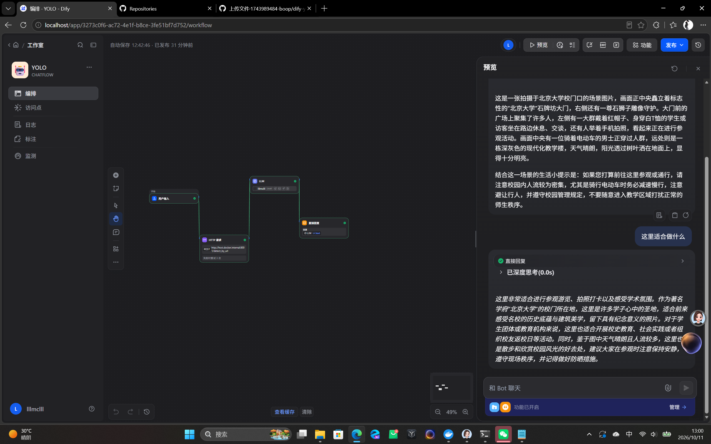


# 本地实景图像解析助手
人工智能协会创智部二面实战项目



## 项目目录
dify-yolo-scene-assistant/
├── assets/ # 存放项目演示截图
│ └── demo.png
├── main.py # YOLO FastAPI 推理服务主程序
├── .gitignore # Git 忽略配置，过滤权重、缓存等文件
├── README.md # 项目说明文档
└── worklog.md # 工程工作日志，记录踩坑与开发进度

> 注：`best.pt`为YOLO训练权重，本地运行放置项目根目录，**不提交到Git仓库，使用者自行准备**。

## 对应面试任务
- ✅ 任务一：本地大模型部署 + 搭建智能体
使用 Ollama 部署本地大模型，Dify搭建智能体作为模型服务提供者，通过API提供大模型能力。
- ✅ 任务二：YOLO跑通
基于ultralytics完成YOLO模型训练；使用Python FastAPI开发推理服务；将YOLO能力接入Dify应用。
- ⭕ 任务三：硬件结合（进阶）：未实现
- ⭕ 任务四：Harness搭建（进阶选做）：完成调研与容器化尝试，无可用运行版本，完整踩坑记录见 worklog.md
- ✅ 任务五：创意作品：本地实景图像解析助手

> AI使用说明：项目大量借助AI完成代码编写、问题排查、方案设计；人工负责方案取舍、链路调试、文档整理。

## 项目简介
创意作品**本地实景图像解析助手**，整套系统全部本地运行，不依赖公有云端大模型API。
用户上传图片，YOLO完成目标检测，输出画面内物体类别列表；本地Ollama大模型基于物体列表完成场景解析，同时支持用户多轮追问。

> ⚠️ 系统局限：大模型不能直接读取图片像素，仅依靠YOLO输出的物体类别做推理，存在幻觉、误判可能性。

## 工作流程
1. 用户在Dify对话界面上传图片；
2. Dify获取图片URL，调用YOLO接口：`http://host.docker.internal:8001/detect_by_url`；
3. YOLO返回检测到的物体类别数组；
4. 将物体列表送入Ollama本地大模型；
5. 大模型输出场景判断、场景描述、实用提示，支持用户继续提问。

## 环境依赖
```bash
pip install fastapi uvicorn ultralytics requests

运行步骤
1. 将训练好的 best.pt 放到项目根目录；
2. 启动 YOLO 推理服务

uvicorn main:app --host 0.0.0.0 --port 8001

启动 Ollama，拉起所需本地大模型；
4. 启动 Docker 版 Dify，导入配置完成的工作流，绑定 Ollama 模型提供者；
5. 在 Dify 对话页面上传图片即可测试。

关于进阶任务 4 Harness
Harness 属于选做进阶任务。
我尝试把 YOLO 推理服务容器化作为 Harness 组件，目标是接入 Dify 的 Docker 网络，规避宿主机访问问题。
调试过程反复遇到 OpenCV 动态链接库缺失、各类包依赖冲突，尝试更换基础镜像、opencv‑headless、xvfb 虚拟显示等方案仍无法稳定运行。
权衡时间成本，优先保障任务 1、任务 2、创意作品完整可用，全部踩坑过程记录在 worklog.md。

仓库文件说明
• main.py：YOLO FastAPI 后端推理接口，精简输出，只返回物体类别；
• worklog.md：工程日志，记录开发过程、报错现象、排查思路与方案取舍；
• assets/demo.png：项目运行演示截图；
• .gitignore：屏蔽模型权重、python 缓存、环境文件，保持仓库干净。



